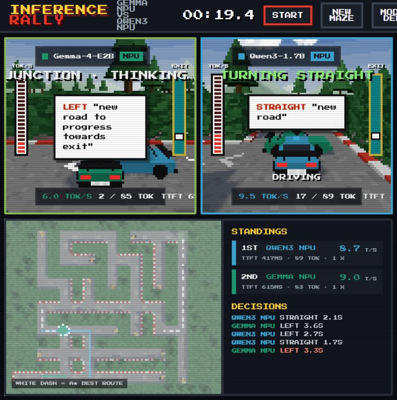
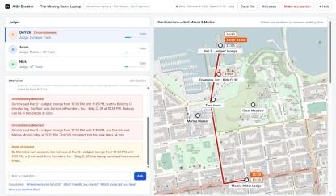
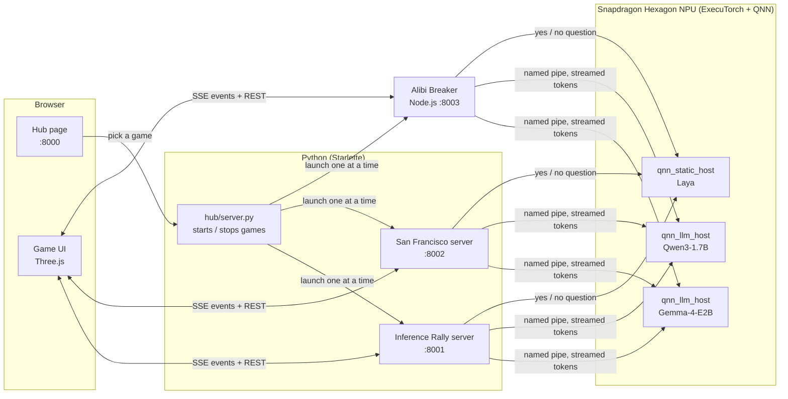

# Game Hub — On-device AI racing on the Snapdragon NPU

> AI models drive taxis through mazes and real San Francisco streets, and lie to a detective about
> where they were. Every answer is compute — and all of it runs on the laptop's **Hexagon NPU**
> with **ExecuTorch**.

**ExecuTorch Hackathon — Compute Track** · Copilot+ PC · **Snapdragon X Elite (SC8380XP)** · Windows on ARM


At every junction each racer's model is asked *left, right or straight?* — and its car **waits
while the model thinks**. Faster on-device inference visibly wins; better decisions find the exit.
Nothing is simulated in the main modes: every racer is a real model on the NPU.

| | |
|---|---|
| **Inference Rally** — a random hedge maze, new every race | **San Francisco** — real OpenStreetMap streets: North Beach, Alamo Square, Mission |
|  |  |

**Alibi Breaker** is a detective game. Gemma-4-E2B plays the suspects, Qwen3-1.7B takes notes,
Laya reads their nerves, and plain code checks every alibi against real walking times on SF streets.



## Quick start

On a Snapdragon X Elite laptop with the [QAIRT SDK](docs/npu-setup.md#1-qairt-sdk), ARM64
Python 3.12 and Node.js:

```powershell
git clone https://github.com/divyachandana/gamehub.git
cd gamehub
.\setup.ps1      # Python env, the games' frontends, paths, NPU checklist
.\run.ps1        # the hub -> http://localhost:8000
```

The model files (`.pte`) and the built NPU runtime are **not in the repo** (5+ GB): get them as
described in **[docs/models.md](docs/models.md)** and drop them into `npu/`. `setup.ps1` lists
exactly what is missing; without them the games still run with simulated racers.

Pick a game in the hub (click, or press **1** / **2** / **3**). The hub starts that game's server,
loads the models on the NPU and opens it. In the racing games press **Enter** to race; in Alibi
Breaker, open a case and start asking questions.

| Key | Action | | Key | Action |
|---|---|---|---|---|
| Enter | start / rematch (same maze) | | S | stop the race |
| N | new maze | | G | mode: DEMO → PLAY → UNFAIR |
| ← ↑ → ↓ | drive (PLAY mode) | | A | next map area (San Francisco) |
| 1 / 2 / 3 | one racer full screen | | 4 | map full screen |
| M / P | sound / retro pixels | | H | back to the hub (◀ HUB button) |

## The models — all on the NPU

| Model | Role | Runtime on the NPU | Speed (measured on this laptop) |
|---|---|---|---|
| **Gemma-4-E2B** | Racer: reads the junction, answers `{"move", "why"}` · the suspect in Alibi Breaker | ExecuTorch QNN `.pte`, 4k context, served by `qnn_llm_host` | ~165 ms to first token · ~13.7 tok/s alone |
| **Qwen3-1.7B** | Racer (and the rogue in UNFAIR mode), `/no_think` · Alibi Breaker's note-taker (JSON) | ExecuTorch QNN `.pte`, 8k context, served by `qnn_llm_host` | ~170 ms to first token · ~12 tok/s alone |
| **Laya** (ModernBERT-large, 421M) | The rogue's instinct: *cheat now?* as a calibrated yes/no · Alibi Breaker's stress meter | ExecuTorch QNN `.pte` (fp16), one forward pass per question | ~0.3 s per question |

When both racers share the NPU in a race, each runs at ~8–13 tokens/s. Details, file names and how
to get each model: **[docs/models.md](docs/models.md)**.

## Modes

| Mode | Racers | What it shows |
|---|---|---|
| **DEMO** | Gemma-4-E2B vs Qwen3-1.7B | Two models sharing one NPU: decision quality vs speed |
| **PLAY** | You (arrow keys) vs Gemma vs Qwen3 | Human reaction time vs NPU inference |
| **UNFAIR** | Honest Gemma vs a **rogue** Qwen3 | The rogue may **hop a hedge** or fly a **scouting drone**; **Laya** decides when |


## Architecture



Only one game runs at a time; all of them reuse the same NPU model hosts, so switching games doesn't
reload the models. More diagrams (a decision's round trip, the rogue's cheat flow, the processes):
**[docs/architecture.md](docs/architecture.md)**.

## What we built on ExecuTorch

- **A persistent NPU LLM server** — `qnn_llm_host` loads a QNN `.pte` once and serves streamed
  generations over a Windows named pipe (newline-delimited JSON), with a **context reset** so every
  junction is a fresh one-shot request ([source](npu/host/src/qnn_llm_host_reset.cpp)).
- **A runner fix for mixed exports** — the Qwen3 `.pte` has a 3-D attention mask, Gemma's a 4-D one;
  the stock runner crashed on Qwen3 after prefill. The [patch](npu/patches/executorch-runner-mask-rank.patch)
  reads the mask's last two dimensions, so one host binary runs both.
- **Three NPU models side by side** — two LLM racers plus Laya, sharing the Hexagon NPU live.
- **The same hosts from Node.js** — Alibi Breaker speaks the pipe protocol from JavaScript
  ([src/npu.js](games/alibi-breaker/src/npu.js)). It folds multi-turn interviews into one-shot
  prompts that fit the compiled context, and repairs the 1.7B note-taker's JSON.
- **Laya on QNN** — a ModernBERT decision model exported to a static-shape QNN graph
  ([export](npu/laya/export_laya_qnn.py)), tuned with natural-language situations ("a huge
  shortcut", "the rival is about to win") because numbers barely moved it.
- **Client-side metrics** — time to first token and tokens/s are measured identically for every racer.

## Repository

```
├── setup.ps1 / run.ps1     one-time setup / start the hub
├── hub/                    landing page + game launcher (port 8000)
├── games/
│   ├── inference-rally/    hedge-maze game (port 8001) — its own README, tests, history
│   ├── san-francisco/      real-streets game (port 8002) — from OpenStreetMap
│   └── alibi-breaker/      detective game (port 8003, Node.js) — its own README and history
├── npu/                    the ExecuTorch side
│   ├── host/               qnn_llm_host.exe + backend DLL (built, git-ignored) · src/ sources
│   ├── models/             Gemma / Qwen3 .pte + tokenizers (git-ignored)
│   ├── laya/               Laya host, export script, model (git-ignored .pte)
│   ├── patches/            ExecuTorch runner patch
│   └── tools/, start_host.ps1, setup_env.ps1   chat with a model on the NPU by hand
└── docs/                   architecture, models, NPU setup, images
```

## Docs

- **[docs/architecture.md](docs/architecture.md)** — system, processes, a decision's round trip, the rogue
- **[docs/models.md](docs/models.md)** — every model and file, where it goes, how to get it
- **[docs/npu-setup.md](docs/npu-setup.md)** — QAIRT SDK, building the NPU hosts, running a model by hand, troubleshooting
- Games: [Inference Rally](games/inference-rally/README.md) · [San Francisco](games/san-francisco/README.md) · [Alibi Breaker](games/alibi-breaker/README.md) · [Hub](hub/README.md)

## Checks

```powershell
cd games\inference-rally; ..\..\.venv\Scripts\python -m pytest; cd ..\..
cd games\san-francisco;   ..\..\.venv\Scripts\python -m pytest; cd ..\..
```

## Credits & licenses

San Francisco streets by Ashwini S
([PR #1](https://github.com/divyachandana/Inference-Rally/pull/1)) · Alibi Breaker by Ashwini S
([alibi-breaker](https://github.com/AshwiniSettu/alibi-breaker)) · Gemma (Gemma Terms of Use) ·
Qwen3 (Apache-2.0) · [Laya](https://huggingface.co/convaiinnovations/laya) by Convai Innovations
(Apache-2.0) · Map data © OpenStreetMap contributors (ODbL) · Press Start 2P font (SIL OFL).
