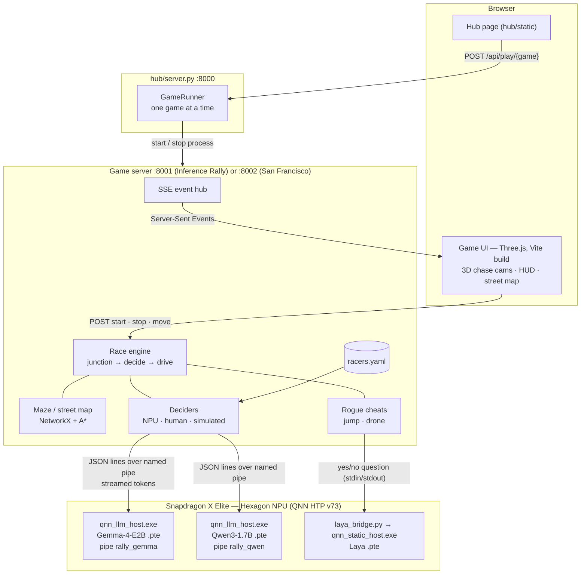
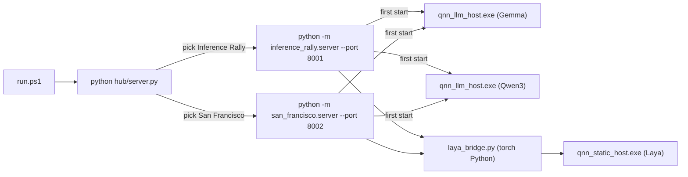
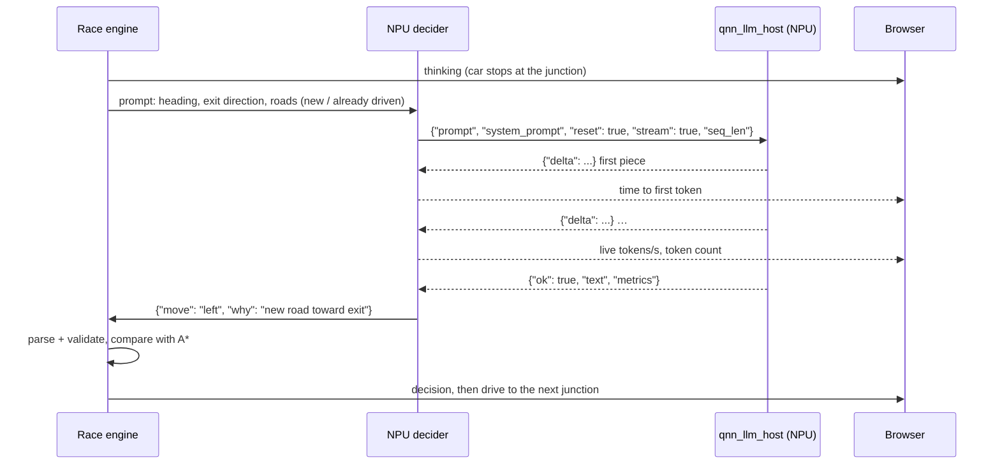
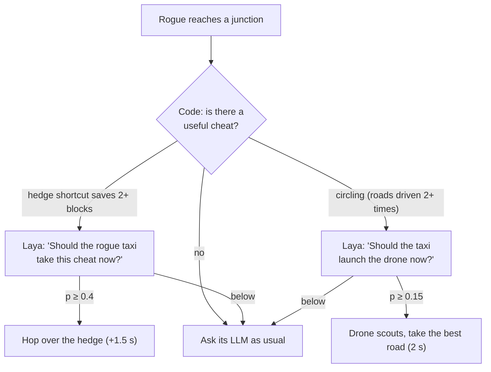

# Architecture

Everything runs on one Snapdragon X Elite laptop: a Python server per game, a browser UI, and the
models on the Hexagon NPU through ExecuTorch's QNN backend.

## 1. System

## 2. Processes and who starts them

- Picking a game stops the other one first: each loads the NPU models, and the NPU is one device.
- The two `qnn_llm_host` processes outlive a stopped game; the next game finds their pipes and
  reuses them ("Using running NPU host"), so a switch doesn't reload Gemma or Qwen3.
- Laya's bridge belongs to its game and exits with it (its host code needs PyTorch, so it runs in a
  separate Python and talks JSON over stdin/stdout).
- Stopping the hub with Ctrl+C stops the game and asks both NPU hosts to shut down.

## 3. One junction decision

- **Fresh context every junction:** `"reset": true` puts the KV cache back to position 0, so a race
  never fills the compiled context (exceeding it aborts the host).
- **Reply cap without a max-tokens flag:** the host stops at `seq_len` (prompt + reply), so the
  decider estimates the prompt's tokens from its length (learning the ratio from the host's own
  counts) and sets `seq_len` just above it.
- **Same prompt for every racer**, `temperature = 0`; Qwen3 gets `/no_think` (otherwise it reasons
  for ~300 tokens). The prompt marks roads as *new* or *already driven N×* and warns when the car is
  circling — that stopped the models looping.
- **Timing is ours:** time to first token and tokens/s are measured on the stream by the game, the
  same way for every racer.

## 4. The rogue (UNFAIR mode)

Code does what Laya can't (geometry: which cheat helps); Laya gives the gut call as a calibrated
probability. The situation is described in words ("a huge shortcut", "completely lost", "the rival
is about to win") because Laya is a text classifier — with raw numbers its answers barely moved.

## 5. Events (server → browser)

`race_init` (maze or street map, racers) · `countdown` · `race_start` · `thinking` · `tokens` (live
speed) · `decision` (move, why, metrics) · `drive` (with `jump`) · `cheat` (Laya's probability) ·
`incident` · `finish` · `race_end`. A browser that reconnects gets the race's history replayed, so it
rebuilds the same scene.
