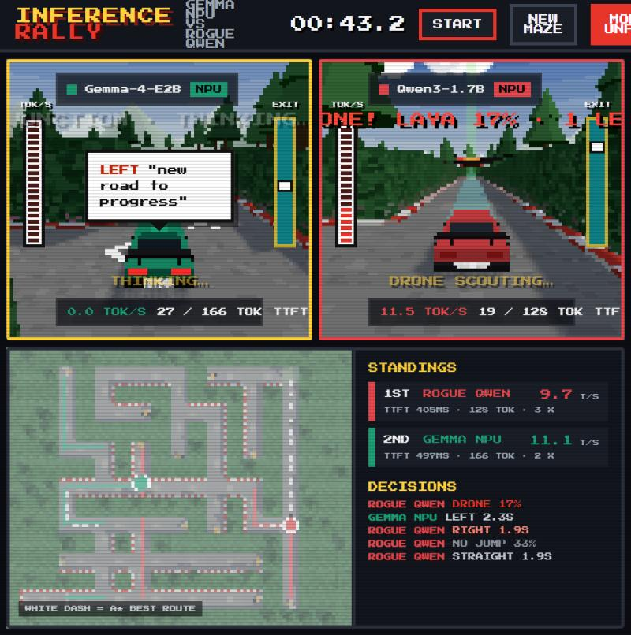
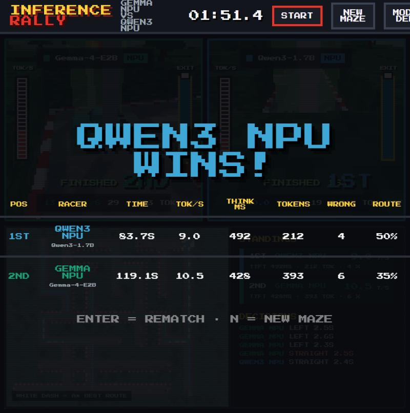

# Inference Rally

> On-device AI models race taxis through a 3D maze. Every turn is a decision; every second is compute.

ExecuTorch Hackathon — Compute Track (Copilot+ PC, Snapdragon X Elite).
Each racer is the same (or a different) model on a different compute unit — **NPU vs GPU**.
At every junction the model is asked *left, right or straight?* and its car **waits while it thinks**,
so faster on-device inference visibly wins.

See **[docs/PLAN.md](docs/PLAN.md)** for the plan and architecture, and
**[docs/CODING_STANDARDS.md](docs/CODING_STANDARDS.md)** for coding rules.

## Demo video

[](https://youtu.be/c1g9Ugve1Pw)

▶️ **[Watch the demo on YouTube](https://youtu.be/c1g9Ugve1Pw)**

## Screenshots


| UNFAIR mode: the rogue's drone scouts a junction | Race results |
|---|---|
|  |  |

## Three modes

| Mode | Racers | Needs |
|---|---|---|
| **DEMO** (default) | **Gemma-4-E2B** vs **Qwen3-1.7B**, both on the Snapdragon NPU (real, ExecuTorch + QNN) | the QNN bundle |
| **PLAY** | **DC (you, arrow keys)** vs **Gemma-4-E2B** and **Qwen3-1.7B** on the NPU (both real) | the QNN bundle |
| **UNFAIR** | Honest **Gemma-4-E2B** vs a **rogue Qwen3-1.7B** that cheats when **Laya** says so (all three on the NPU) | QNN bundle + Laya |

Switch with **G** (or the MODE button: DEMO → PLAY → UNFAIR). Lineups live in `racers.yaml` (`demo`,
`play`, `unfair`, and `sim`, which is fully simulated and runs on any machine:
`python -m inference_rally.server --profile sim`).

DEMO and PLAY race only real models. Both share the one NPU during a race, so each runs slower than
it would alone (~8–9 tokens/s instead of ~12–14). The `sim` profile's racers are labelled **SIM**.

## How the NPU racers work

For each model under `qnn.models` in `racers.yaml`, the game server launches `host\qnn_llm_host.exe`
from the [ExecuTorch QNN bundle](https://github.com/divyachandana/gamehub) and talks to it over the
named pipe `\\.\pipe\rally_<model>` (e.g. `rally_gemma`, `rally_qwen`). Each model is loaded once
(~2–3 s, in the background while the title screen shows) and stays loaded across races. Each junction
is a one-shot request (`"reset": true`), streamed token by token so TTFT and tokens/sec are timed on our
side. If a host is already serving the pipe (e.g. started with the bundle's `start_host.ps1
-PipeName rally_gemma`), the game reuses it. Host output goes to `logs/qnn_<model>.log`.

Qwen3 gets `/no_think` appended to each prompt (`prompt_suffix`), otherwise it reasons for hundreds of
tokens before answering; its empty `<think></think>` block and end-of-turn markers are stripped.

The host must be built with the runner fix that reads the attention-mask shape from its last two
dimensions: the Qwen3 `.pte` was exported with a 3-D mask and the Gemma one with a 4-D mask, and a
runner that indexes fixed dimensions crashes on one of them right after prefill.

If an NPU host can't start, its car shows "MODEL OFFLINE" and keeps going with fallback moves.

## UNFAIR mode: the rogue and Laya

The rogue (red car, `rogue:` in `racers.yaml`) may break the rules:

| Cheat | What happens | Cost | Per race |
|---|---|---|---|
| **Hedge jump** | Hops over the bushes to the neighbouring junction where there is no road | +1.5 s | 3 |
| **Drone peek** | When it is circling, a drone rises over the car, scouts the junction and the car takes the best road | 2 s | 2 |

Code spots a cheat only when it would help: a jump must cut the rogue's route by at least 2 road
blocks, a drone is offered only when the rogue keeps revisiting roads. Then
[Laya](https://huggingface.co/convaiinnovations/laya), a ModernBERT decision model running on the NPU
(~0.3 s per question), answers a yes/no question about the situation, and the rogue cheats if Laya
says yes with probability ≥ `threshold` (0.4 for jumps) or `drone_threshold` (0.15: Laya rates
drones lower, about 0.17 when the rogue is slightly unsure up to 0.54 when it is lost with the rival
close). The HUD shows Laya's call ("HEDGE JUMP! LAYA 52%", "DRONE! LAYA 17%"), the car arcs over the
hedge or a drone rises over it to scout, and the results table counts each racer's cheats.

Laya is a text classifier, not a calculator, so the situation is described in words ("a huge shortcut
that skips most of the route", "the rival is about to win the race") rather than numbers; with numbers
its answers barely moved. The jump and drone questions and thresholds were tuned on sample
situations: Laya takes good and huge shortcuts, mostly skips tiny ones, and flies the drone as soon as
the rogue starts circling.

Laya's host code needs PyTorch + transformers, so the game runs it via `scripts/laya_bridge.py` in the
Python set under `laya:` (`C:\dev\et-venv` here), loading the QNN-compiled Laya from the local
`laya_x_elite` folder set as `laya_dir`. Output goes to `logs/laya.log`. If Laya can't start, the rogue simply races honestly.

## Quick start (Windows on Snapdragon)

Needs:
- the QAIRT SDK (`C:\Qualcomm\AIStack\QAIRT\2.46.0.260424`);
- the [ExecuTorch QNN bundle](https://github.com/divyachandana/gamehub) with both models under
  `models\` (`.pte` + `tokenizer.json` each, git-ignored there, copy them in):
  `gemma4_e2b_sc8380xp_ctxt_4000_ar_l-128\` and `sc8380_qwen3-1_7b_ctxt-8000\`;
- a patched `host\qnn_llm_host.exe` in that bundle (see [Building the NPU host](#building-the-npu-host)).

Adjust `qnn:` in `racers.yaml` if these live elsewhere. To try the game without any of them, run
`.venv\Scripts\python -m inference_rally.server --profile sim` (all racers simulated).

```powershell
# 1. Python game server (once) — ARM64 Python 3.12
py -3.12-arm64 -m venv .venv
.venv\Scripts\python -m pip install -e ".[dev]"

# 2. Frontend (once)
cd frontend; npm install; npm run build; cd ..

# 3. Run (serves the built UI)
.venv\Scripts\python -m inference_rally.server
```

Open <http://localhost:8000> and press **Enter**. For frontend work with hot reload, run
`.\scripts\dev.ps1` instead (server on :8000, Vite UI on <http://localhost:5173>).

In PLAY mode the overview map is locked until you finish — like the models, you only know where the
exit is (follow the green beam).

### Building the NPU host

`qnn_llm_host.exe` is built from an ExecuTorch checkout (ours: `fde20d91` in `C:\dev\executorch`,
configured as in the bundle's `.claude/skills/setup`). Its runner must read the attention-mask shape
from the last two dimensions, because the Gemma `.pte` has a 4-D mask and the Qwen3 one a 3-D mask;
the stock runner indexes fixed dimensions and crashes on Qwen3 right after prefill. Apply
[`docs/patches/executorch-runner-mask-rank.patch`](docs/patches/executorch-runner-mask-rank.patch)
and rebuild just the host:

```powershell
cd C:\dev\executorch
git apply C:\path\to\Inference-Rally\docs\patches\executorch-runner-mask-rank.patch
cd build-arm64-windows
& "C:\Program Files (x86)\Microsoft Visual Studio\2022\BuildTools\MSBuild\Current\Bin\arm64\MSBuild.exe" `
  examples\qualcomm\oss_scripts\llama\qnn_llm_host.vcxproj /p:Configuration=RelWithDebInfo /p:Platform=ARM64 /m
```

Copy `examples\qualcomm\oss_scripts\llama\RelWithDebInfo\qnn_llm_host.exe` to the bundle's `host\`
folder (next to its `qnn_executorch_backend.dll`).

### Controls

| Key | Action |
|---|---|
| Enter | Start / rematch (same maze) |
| S | Stop the race (back to the title screen, same maze) |
| N | New random maze |
| G | Switch DEMO / PLAY / UNFAIR |
| ← ↑ → | Drive at a junction (PLAY): left / straight / right |
| ↓ | U-turn (PLAY) |
| M | Sound on/off |
| P | Retro pixels on/off |
| 1 / 2 / 3 | Focus one racer full screen |
| 0 / Esc | Back to split screen |

## Layout

- `src/inference_rally/` – Python game server
  - `maze.py` seeded maze + A* · `race.py` race engine · `deciders.py` racers' brains: simulated, models on the NPU, human
  - `qnn_host.py` launches `qnn_llm_host.exe` and speaks its named-pipe protocol
  - `rogue.py` spots useful cheats and describes them for Laya · `laya.py` runs Laya via `scripts/laya_bridge.py`
  - `prompts.py` junction prompt + reply parsing · `metrics.py` TTFT / tokens/sec timing
  - `models.py` typed config + event schema · `server.py` Starlette + Server-Sent Events
- `frontend/` – Three.js split-screen game (Vite)
  - `world/` maze, scenery, procedural pixel textures · `cars/` car model, driving, option arrows
  - `render/` split-screen viewports, overview map · `hud/` HUD, leaderboard, overlays · `audio/` chiptune synth
- `racers.yaml` – race settings, NPU bundle and models (`qnn:`) and racer profiles (`demo`, `play`, `sim`)
- `tests/` – pytest suite (game logic runs offline with simulated racers)
- `scripts/` – `dev.ps1` (Windows) / `dev.sh` run server + UI
- `docs/` – plan, architecture, coding standards

## Checks

```bash
ruff check . && ruff format --check . && mypy src && pytest
```
