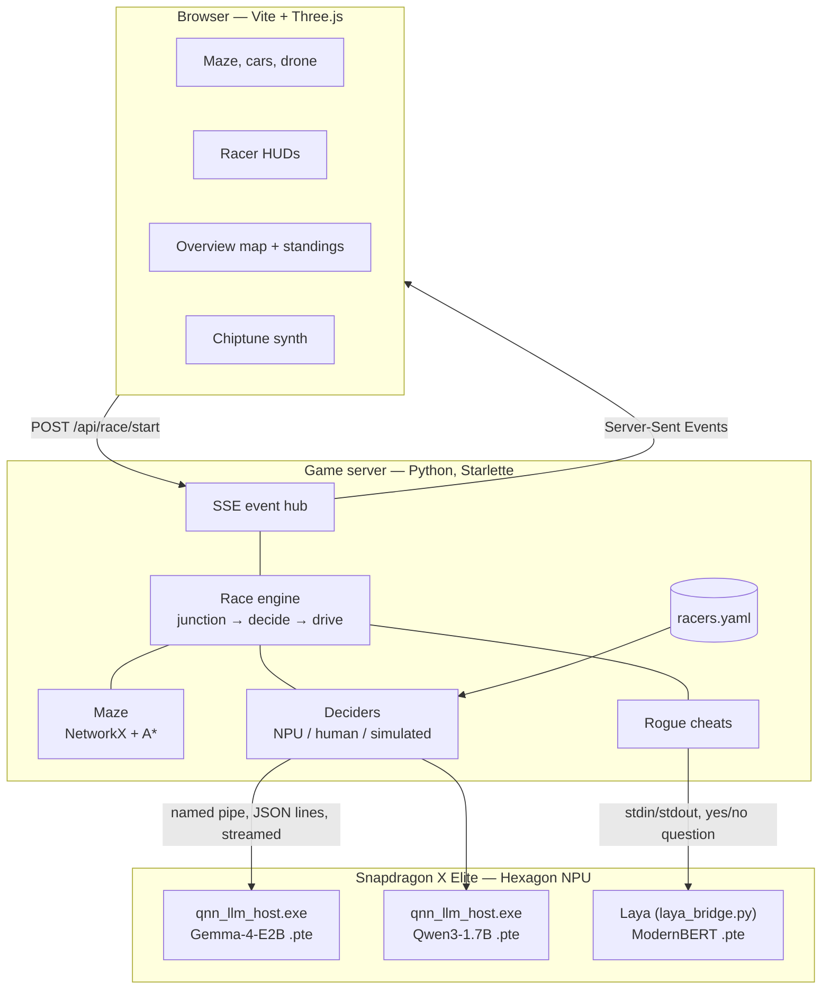
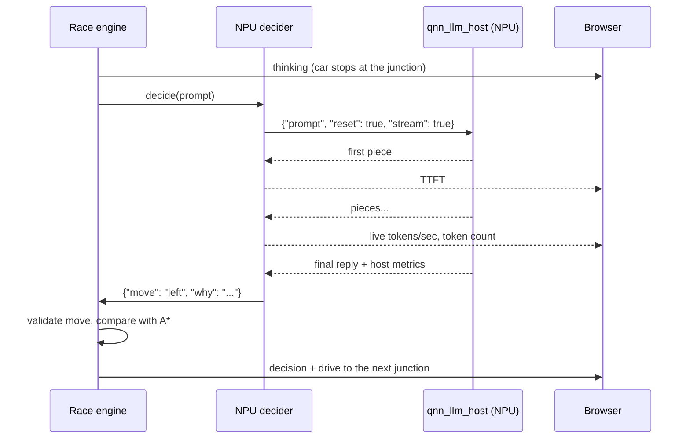

# Inference Rally — Design

> On-device AI models race taxis through a 3D maze. Every turn is a decision; every second is compute.

**Hackathon:** ExecuTorch Hackathon — Compute Track (Copilot+ PC, Snapdragon X Elite)

---

## 1. Goal

Show, visually and live, how on-device models running on the **Snapdragon NPU** (ExecuTorch + QNN)
**make decisions** and **how fast they make them**.

- Each racer is a real model on the NPU (Gemma-4-E2B, Qwen3-1.7B), the human player, or a rogue
  that may cheat.
- All racers start at the same spot, in the same maze, with the same exit.
- At every junction the racer's model is asked: *left, right, straight or back?*
- While the model thinks, its taxi **waits at the junction**, so slow inference visibly loses.
- HUD per racer: model, device, live tokens/sec, tokens used, time to first token, status.

### Race modes

| Mode | Racers | What it shows |
|---|---|---|
| **DEMO** | Gemma-4-E2B vs Qwen3-1.7B, both on the NPU | Decision quality and speed of two models sharing one NPU |
| **PLAY** | You (arrow keys) vs Gemma vs Qwen3 | Human reaction time vs NPU inference |
| **UNFAIR** | Honest Gemma vs a rogue Qwen3 that cheats when Laya says so | Rule-breaking judged by a third NPU model |

A fully simulated `sim` profile runs anywhere, without an NPU (UI work, tests).

---

## 2. Game view

- **3D arcade racer, chase camera** low behind each car, retro look: Three.js rendered at low
  resolution and upscaled with crisp pixels, pixel font, fog, sky and hills, red/white curbs.
- **Maze**: grid road network walled by hedges and trees; models can't see the exit, only its
  direction, so every junction is a decision.
- **Layout**: split screen, one chase-cam pane per racer plus an overview pane (top-down map +
  standings + decision feed). With two racers the overview spans the bottom row.
- **HUD per pane**: tokens/sec bar, progress-to-exit bar, event banner (thinking, wrong turn, dead end,
  cheats), thought bubble with the model's reason, tokens, TTFT.
- **Dead ends** are marked by a burning wreck; a green beam marks the exit.

## 3. Gameplay rules

- The maze is generated from a seed, so every racer (and every rematch) gets the identical maze.
- A racer sees only its heading, the exit's direction and distance, and the roads at its junction
  (with how often it already drove each one): no full map.
- The decision prompt is small and identical for all racers, `temperature=0`, short replies.
- The model answers JSON: `{"move": "left", "why": "new road toward exit"}`; `why` shows in a bubble.
- An invalid answer counts as a mistake and the car takes a fallback move.
- The race ends when every racer arrives, or a racer hits the decision limit (DNF).

### Decision prompt

```
You drive a taxi through a city maze to reach the exit. At each junction choose one road.
Roads you already drove lead back to places you have been, so prefer a road you have not
driven yet. Reply with JSON only.

You are facing west.
Exit: 3 blocks east, 1 blocks north.
Roads you can take:
- left (goes south, new road)
- right (goes north, already driven 2x)
- back (goes east, already driven 3x)
You are driving in circles. Take a new road: left.
Pick exactly one of: left, right, back.
Reply: {"move": "<your pick>", "why": "<max 6 words>"}
```

Qwen3 gets `/no_think` appended so it answers directly instead of reasoning for hundreds of tokens.

### UNFAIR mode cheats

| Cheat | Effect | Cost |
|---|---|---|
| Hedge jump | Hop over the hedge to the neighbouring junction (only offered if it saves 2+ road blocks) | +1.5 s |
| Drone peek | When circling, a drone scouts the junction and the car takes the best road | 2 s |

Code offers at most one useful cheat per junction; **Laya** (a ModernBERT decision model on the NPU,
~0.3 s per question) answers a yes/no question about it, described in words, and the rogue cheats if
the probability clears the threshold (0.4 for jumps, 0.15 for the drone).

---

## 4. Metrics

| Metric | How it is measured | Shown where |
|---|---|---|
| TTFT (time to first token) | Timed by our client on the streamed reply | HUD + leaderboard |
| Tokens/sec | tokens after the first ÷ (last token − first token) | HUD (live) + leaderboard |
| Tokens per decision / total | Host-reported count, else streamed pieces | HUD + leaderboard |
| Wrong turns / invalid moves | Compared with the A* next step / reply parsing | HUD + leaderboard |
| Route efficiency | A* optimal length ÷ distance actually driven | Results |
| Cheats | Rogue cheats taken | Results (UNFAIR) |
| Finish time & place | Game clock | Results screen |

All timing is done by **our own client**, so every racer is measured the same way.

---

## 5. Architecture



The game server launches each NPU host itself (one `qnn_llm_host.exe` per model, from the ExecuTorch
QNN bundle) and talks to it over a Windows named pipe; each junction is a one-shot request with a
fresh context. Laya's host code needs PyTorch, so it runs in a separate Python via
`scripts/laya_bridge.py`.

### One decision turn



---

## 6. Tech stack

| Layer | Choice |
|---|---|
| Inference | **ExecuTorch QNN backend** on the Hexagon NPU: `qnn_llm_host.exe` serving Gemma-4-E2B and Qwen3-1.7B `.pte` files; Laya (QNN `.pte`) for the rogue's cheat calls |
| Game server | Starlette + sse-starlette, Uvicorn, Pydantic, asyncio |
| Maze + pathfinding | NetworkX (graph + A*) |
| Frontend | Three.js, bundled with Vite; procedural models and textures, no asset files |
| Audio | Web Audio chiptune synth |
| Config | `racers.yaml` (models, lineups, cheat settings) |

---

## 7. Risks & mitigations

| Risk | Mitigation |
|---|---|
| Exceeding a model's compiled context aborts its host | One-shot requests with `"reset": true`; the reply length is capped below the context |
| Export and runner disagree on the attention-mask shape (3-D vs 4-D) | Runner patch that reads the mask's last two dimensions (`docs/patches/`) |
| Several models share one NPU and slow each other down | Shown honestly: tokens/sec are measured live during the race |
| A model or Laya fails to start | Its car shows "MODEL OFFLINE" and drives fallback moves; the rogue races honestly without Laya |

---

## 8. Coding standards

All code follows **[CODING_STANDARDS.md](CODING_STANDARDS.md)**: single-responsibility modules, type
hints + Pydantic models, Google-style docstrings, *why*-comments, `logging` not `print`, ruff + mypy +
pytest before every commit.

## 9. Ideas

- AI race commentator: a small local model writes one-liners for each incident
- Vision racer: the model gets a screenshot of its view at each junction
- Power draw per racer
- Replay viewer for past races
