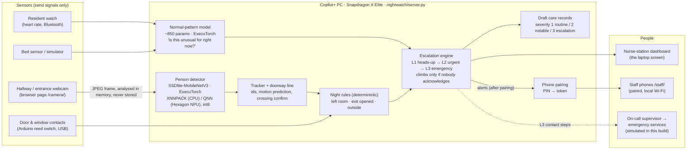

# NightWatch architecture

Everything below runs on one Copilot+ PC at the nurse station. Phones reach it over the facility's own Wi-Fi.
Nothing goes to the cloud.

## What each part does

| Part | File | What it decides | AI or rule |
|---|---|---|---|
| Person detector | `nightwatch/vision/detector.py`, `export_detector.py` | Where people are in a camera frame | **AI** (ExecuTorch .pte, CPU or NPU) |
| Tracker | `nightwatch/vision/tracker.py` | Same person across frames; did their feet cross the doorway line, which way | Logic over AI output |
| Normal-pattern model | `nightwatch/model/train_anomaly.py`, `scorer.py` | How unusual this moment is for a resident (time, bed, movement, heart rate, zone, minutes up) | **AI** (ExecuTorch .pte) |
| Night rules | `nightwatch/engine.py` | Left the room at night, exit door/window opened, resident outside | Deterministic, on purpose |
| Escalation engine | `nightwatch/engine.py` | Level, countdowns, contact steps, auto-clear, quiet period after "found safe" | Deterministic |
| Care records | `nightwatch/engine.py` (`_care_record`) | Draft entry in the care team's taxonomy, severity badge | Deterministic |
| Pairing | `nightwatch/pairing.py`, `web/assets/auth.js` | Which devices may read or answer alerts | Deterministic |

**Design rule:** rules for what we know is dangerous, AI for what we have to *see* or *judge in context*. Safety-critical
escalation stays predictable.

## Data that exists, and where

| Data | Where it lives | Leaves the laptop? |
|---|---|---|
| Camera frames | Browser memory → server memory, dropped after inference | **Never** stored or sent |
| Track positions (boxes, ids) | Server memory, last 3 s | Only to paired screens on the local network |
| Sensor readings, alerts, care-record drafts | Server memory (this build) | Only to paired screens on the local network |
| Paired phones | `logs/paired_devices.json` (token **hashes**) | No |
| De-identified care records used in design | `data/` (git-ignored), aggregate summaries only | No |

## Camera privacy controls

Each camera can be **off**, **always on**, or **night only (21:00–05:00)**, from the camera page, dashboard or presenter
page. Off means the server drops frames without decoding them and the camera page releases the webcam. Every change is
logged with who made it.

## Honest limits of this build

- The normal-pattern model learned "normal" from **simulated** days; in a facility it would learn each resident's own pattern.
- Demo residents are **synthetic**. The camera "walk-out" presenter scenario is **simulated** and labelled as such.
- The L3 contact chain is **simulated**: it never calls or texts anyone. A real deployment would connect it to the nurse-call
  system or a phone/SMS line (the only part that would leave the building, carrying alert text only).
- NPU numbers come from the team's benchmark run on the Snapdragon laptop (`nightwatch/bench/`); see README.
- Not a medical device: it supports staff, it doesn't replace them.
