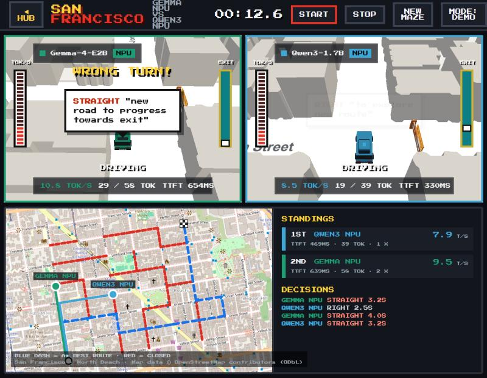

# San Francisco

> On-device AI models race taxis through real San Francisco streets, live on the Snapdragon NPU.

The sister game of [Inference Rally](../inference-rally/README.md): the same race on real streets from
[OpenStreetMap](https://www.openstreetmap.org) instead of a hedge maze. Its own Python package
(`san_francisco`), server, frontend and config; it shares only the NPU setup. Started from
[PR #1](https://github.com/divyachandana/Inference-Rally/pull/1) by Ashwini S.



## The game

- **Real streets:** North Beach (default), Alamo Square or the Mission; the **MAP** button (or **A**)
  cycles them. Each race closes some streets with barricades so it is still a maze (`N` closes a
  different set). Buildings take their block's real height, parks are parks, the junction banner
  shows the real cross streets, and the Golden Gate Bridge, Transamerica Pyramid, Salesforce Tower,
  Coit Tower, Alcatraz and the skyline stand in their real directions. The map panel is the real
  OpenStreetMap street map with each car's dot and trail, the best route and the closed streets
  (`4` shows it full screen). Add `?view=city` to the address for a pixel-art city instead.
- **Racers on the NPU,** set up exactly like Inference Rally (`qnn:` and `laya:` in `racers.yaml`):
  real Gemma-4-E2B and Qwen3-1.7B (ExecuTorch + QNN), and Laya deciding a rogue's cheats.
- **Modes (G):** DEMO (Gemma vs Qwen3), PLAY (you vs both, arrow keys), UNFAIR (honest Gemma vs a
  rogue Qwen3 that hops over a city block or flies a scouting drone when Laya says so).
- **STOP (S)** ends a race and returns to the title screen; **◀ HUB (H)** goes back to the
  [game hub](../../hub/README.md).

## Run

Usually through the [game hub](../../hub/README.md): `.\setup.ps1` once, then `.\run.ps1`, at the repo
root. On its own, after `.\setup.ps1`:

```powershell
cd games\san-francisco
..\..\.venv\Scripts\python -m san_francisco.server    # http://localhost:8002
```

It needs the same NPU pieces as Inference Rally (QAIRT SDK, the Gemma / Qwen3 models and the patched
`qnn_llm_host.exe` in `npu/`, and Laya): see [docs/models.md](../../docs/models.md) and
[docs/npu-setup.md](../../docs/npu-setup.md). Without them, `--profile sim` races simulated cars.

## Maps

Add another area with one command, then list the new file under `games: sf: maps:` in
`racers.yaml`:

```bash
python scripts/fetch_map.py sf-alamo-square    # ready: sf-north-beach, sf-alamo-square, sf-mission
python scripts/fetch_map.py my-area --bbox 37.79,-122.42,37.80,-122.40 --title "My area"
```

Any area with a street grid works; the script keeps the 7 x 7 junctions nearest its middle
(`--size` changes that). `loop_ratio: 1` in `racers.yaml` keeps every real street open. Map data
© OpenStreetMap contributors, under the [Open Database License](https://opendatacommons.org/licenses/odbl/).

## Layout

- `src/san_francisco/` – game server: `city_map.py` OpenStreetMap data → real street grid, block
  heights, skyline · `maze.py` maze carved from the real streets · `race.py` race engine ·
  `deciders.py` NPU / human / simulated racers · `qnn_host.py`, `laya.py`, `rogue.py` the NPU models
  and the rogue's cheats · `server.py` Starlette + Server-Sent Events (port 8002)
- `frontend/` – Three.js game: `world/` city blocks, bay area and landmarks placed by
  latitude/longitude · `render/street-map.js` the live street map
- `maps/` – street maps (`<area>.json`), map pictures (`tiles/`), drawn-map data (`features/`)
- `scripts/fetch_map.py` downloads an area · `scripts/laya_bridge.py` runs Laya
- `tests/` – `pytest` (from this folder)
